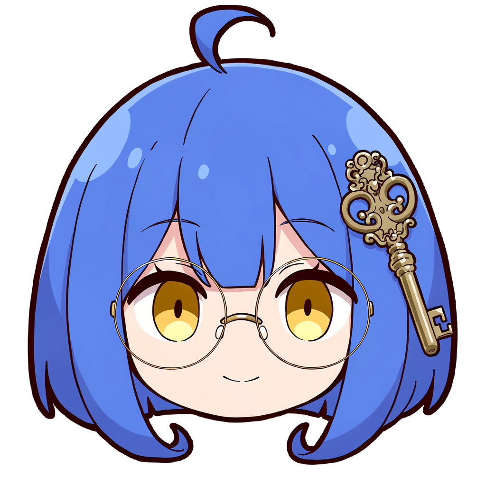

# Egorov 的形象：守钥人

应用图标用的人物头像。源图和重新生成图标的脚本都在这个目录里。



## 设定

叶戈罗娃（Egorova），保险库的守钥人。她管着一间深夜还亮着灯的私人档案室：灰蓝的读书室、旧纸、黄铜配件、牛血红的蜡封。每一把钥匙放在哪儿、哪台机器能开哪扇门，她都记得清清楚楚。

* **头发**：偏矢车菊蓝的齐肩内扣短发，头顶一根呆毛，不管怎么梳都会翘起来。
* **眼镜**：细黄铜框的大圆眼镜。
* **眼睛**：琥珀色，和界面里的黄铜色呼应。
* **钥匙发夹**：画面右侧别着一枚雕花黄铜钥匙，对应登录页上的格言 *Clavis in manu tua*（钥匙在你手中）。
* **神情**：安静、可靠，带一点浅浅的笑。

名字来自 Egorov 定理（叶戈罗夫定理）：在有限测度集上逐点收敛的函数列，几乎一致收敛。她要做的事也差不多，就是让每台设备上的内容都收敛到同一个保险库。

画风和 RieszManager 的看板娘统一：Q 版纯头部贴纸，粗深色描边、平涂加赛璐璐阴影，外面一圈旧纸色贴纸边，在深色主屏幕上也看得清。

## 生成

NovelAI `nai-diffusion-5-full`，1024×1024，steps 28，scale 6，k_euler_ancestral + karras，质量标签开，`ucPreset=0`，V5 原生透明背景，seed `1004090990`。在 Opus 订阅的免费范围内（不超过 1024×1024 像素、不超过 28 步、每次 1 张）。

提示词：

```
chibi, 1.3::disembodied head::, head only, no body, no neck, sticker, thick outline, dark outline, flat color, cel shading, looking at viewer, 1girl, solo, cute, blue hair, cornflower blue hair, 1.2::ahoge::, single ahoge, medium hair, bob cut, inward-curling hair ends, side bangs, hair between eyes, amber eyes, golden eyes, 1.3::large round eyewear::, thin gold-framed eyewear, glasses, key hair ornament, 1.2::large ornate brass key hairpin::, gentle smile, closed mouth, calm, smart, librarian, symmetrical bob, rounded hair silhouette, transparent background. Only the head, the hair ends at the bottom. The brass key hairpin is on the right side of the image.
```

负面：

```
realistic, 3d, photorealistic, pixel art, multiple girls, text, watermark, signature, logo, speech bubble, thought bubble, body, shoulders, clothes, neck, collar, hands, teal hair, aqua hair, cyan hair, green hair, mint green hair, purple hair, black hair, blonde hair, multicolored hair, gradient hair, twintails, ponytail, braid, long hair, animal ears, cat ears, hat, beret, hair ribbon, hair bow, earrings, necklace, sunglasses, red eyes, blue eyes, crying, tears, open mouth, teeth, heavy blush
```

经验：

* 末尾那句自然语言能把钥匙固定在画面右侧。
* `muted / dusty / steel blue` 会让头发变成灰紫色，失去蓝发的辨识度。所以生成时用鲜艳的蓝，后期只降头发的饱和度。

## 后期

```bash
python tone.py head-raw.png 0.82 head.png    # 头发饱和度降到 82%，皮肤、眼睛和钥匙不变
python make_icons.py head.png out/            # 描边、贴纸边，以及各尺寸图标
```

`make_icons.py` 生成的文件（复制到 `src/egorovsystem/server/static/icons/`）：

| 文件 | 用途 |
| --- | --- |
| `icon-192.png`、`icon-512.png` | manifest 里的普通图标，透明底 |
| `maskable-192.png`、`maskable-512.png` | Android 自适应图标：灰蓝底，头像占中央 66%，落在 80% 直径的安全圆内 |
| `apple-touch-icon.png` | iOS 主屏幕图标，180×180，灰蓝底 |
| `favicon-32.png`、`favicon-64.png` | 浏览器标签页图标 |
| `mascot-96.webp`、`mascot-320.webp` | 界面里的标志：登录页、电脑版侧边栏、手机顶栏 |
